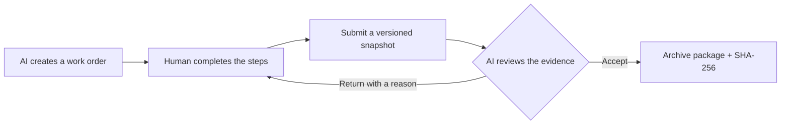

# Human Use

**A local workspace for the steps AI needs a human to complete.**

[中文说明](README.zh-CN.md) · [API reference](docs/API.md) · [Contributing](CONTRIBUTING.md) · [MIT license](LICENSE)

AI agents can write code and call tools, but some steps still require a person:
checking a device, measuring a value, taking a photo, or answering a question.
Human Use turns those handoffs into structured work orders, collects the results,
and preserves the review history in a verifiable local package.

Human Use is an early version for single-user, same-machine workflows. The web
interface is currently in Simplified Chinese. AI integration uses an HTTP API
and a small CLI Bridge; an MCP adapter is planned.

## How it works



Each work order combines the units it needs:

| Unit | Human input |
| --- | --- |
| Checklist | Check off individual steps |
| Text | Write an answer or describe an observation |
| Number | Record a measurement, optionally with a unit |
| Choice | Select one or more options |
| Attachment | Upload photos, screenshots, logs, or files |

Screenshot copied to the clipboard? Click the attachment area and press **Ctrl+V**.
The image is uploaded and previewed immediately. File selection also works.

Drafts can be saved without completing required fields. A person can report why
they are blocked, then resume later. Submissions are preserved as snapshots;
returned work creates a new submission instead of overwriting the previous one.
AI acceptance targets an explicit submission version and hash.

## Quick start

Install **Node.js 24 or newer**, download or clone this repository, and open a
terminal in the checkout:

```sh
npm start
```

Open [http://127.0.0.1:4317](http://127.0.0.1:4317). Keep the server running;
press Ctrl+C in its terminal to stop it. The core server and Skill use only Node.js built-ins and need no build step.
For MCP or the full test suite, first run `npm ci --ignore-scripts`.

The first launch starts with an empty workspace. Click **新建示例** to create a
sample work order. Completing the sample submits it for review; acceptance is
performed through the AI API.

### Configuration

| Environment variable | Default | Purpose |
| --- | --- | --- |
| PORT | 4317 | Local HTTP port |
| WORKORDER_DATA_DIR | ./data for server | Server data directory, resolved from the working directory |
| HUMAN_USE_URL | http://127.0.0.1:4317 | Skill, Bridge, MCP and hook API origin (loopback only) |
| HUMAN_USE_TOKEN_FILE | checkout data/api-token for repository tools | Absolute token-file path; required for a copied Skill unless WORKORDER_DATA_DIR is set |

For example, in PowerShell:

```powershell
$env:PORT = '4318'
$env:WORKORDER_DATA_DIR = Join-Path $env:LOCALAPPDATA 'HumanUse'
npm start
```

Bridge, MCP and Skill can use `HUMAN_USE_URL` and an absolute `HUMAN_USE_TOKEN_FILE`.
Without overrides the repository Bridge and MCP use the checkout’s data directory,
independently of the client’s working directory. Keep custom data directories
outside the checkout.

## Connect an AI agent

From the repository root, after starting the server:

```sh
node tools/bridge.mjs POST /api/tickets examples/ticket.json
node tools/bridge.mjs GET /api/tickets?status=submitted
node tools/bridge.mjs GET /api/tickets/TK-000001
```

The Bridge reads the local data directory's api-token file and sends it as a
Bearer token. It does not print the credential. Agents can also call the HTTP
API directly. Creating a work order returns its ID and local browser URL.

Inspect the latest submission and any relevant attachments, then send a review
with its version, hash, decision (`accept` or `return`), and a reason. See the
[API reference](docs/API.md) for the full contract and review examples.

Use **Skill + API** without MCP by copying [skills/human-use](skills/human-use)
to your client’s skill directory and configuring its token-file path. The bundled
API script works independently of this checkout and needs no npm dependencies.

Alternatively, connect the stdio MCP entry `mcp/server.mjs` after `npm ci --ignore-scripts`.
It provides 10 tools for tickets, original evidence, versioned review, archives,
explicit session bindings, bounded waits and AI activity notices.

The browser now uses SSE with persistent unread receipts and preserves unsaved
input when updates arrive. Optional Codex / Claude hooks route human events to
an explicitly bound session and show selected AI actions on the page. Idle wakeup
depends on the client; Claude asyncRewake is an experimental opt-in, and Codex
uses a bounded Stop window or next-turn catch-up.
See the [integration guide](docs/接入指南.md) and [example configurations](integrations/).
Promotion, package publication and marketplace distribution remain deferred.

## Storage and archive verification

The data directory contains SQLite state, original attachments, archive packages,
and the API token. Stop the service before copying the entire directory for a backup.
Work orders, drafts, and evidence stay in that local directory; the application
uses no cloud storage, external CDN, or telemetry.

Accepted work orders are frozen into a package containing:

```text
ticket.json             Request, units, and attachment metadata
submissions/*.json      Every submitted version
attachments/*           Original uploaded bytes
reviews.json            Acceptance and return decisions
events.json             Workflow history
manifest.json           File paths, byte counts, and SHA-256 hashes
```

The package ID is the SHA-256 of manifest.json. The manifest lists every other
file; its own hash is not embedded in it. JSON serialization and file ordering
are fixed. ZIP is an export container and is not the input to the package ID.

Look up a package by its full hash, verify its contents, and export it as ZIP.
Modified packages fail verification and cannot be exported through the app.

## Privacy and limits

- The service listens only on 127.0.0.1. Remote access and multi-user deployments
  are outside the current scope.
- Connecting a cloud AI client may send whatever it reads to that client's model
  provider. Local storage is separate from where the model runs.
- PNG, JPEG, WebP, and GIF are previewed. Other files are downloaded. Each file
  can be at most 20 MiB.
- Hashes check content consistency. They are not proof of physical actions,
  personal identity, or a digital signature.

See [SECURITY.md](SECURITY.md) for the trust boundaries and vulnerability reporting.

## Development

```sh
npm ci --ignore-scripts
npm test
```

Tests use Node.js's built-in runner and cover submission snapshots, return and
resubmission, stale reviews, draft conflicts, tampering, persistence, HTTP access
boundaries, ZIP contents, durable events, SSE replay, a copied Skill, real SDK
stdio calls and hook routing/exit codes. CI is configured for Node.js 24 on Windows and Linux.
Restricted Windows sandboxes can block loopback connections or directory renames;
run these checks in a normal local terminal.

The implementation uses Node.js HTTP, SQLite, filesystem, and crypto modules,
with plain HTML, CSS, and JavaScript in the browser. Read the
[development discipline](AGENTS.md), [contribution guide](CONTRIBUTING.md), and
[v1 design baseline](docs/方案-v1.md) before making changes.

## License

[MIT](LICENSE), copyright 2026 Human Use contributors.
