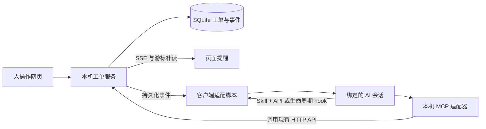

# Human Use 事件通知 MCP 与分发方案

日期：2026-10-15。状态：事件、实时提醒、Skill + API、MCP 和基础 hook 已按 v0.2 实现；归档格式保持原契约。当前开发基线与验证范围见 [接入指南](接入指南.md)。下文保留方案与后续路线，推广和分发尚未决定，不在本轮执行。

## 产品目标

让人和 AI 能在同一张工单上接续工作：AI 发起请求，人收到提醒并提交证据，指定 AI 会话收到可处理的事件，AI 的反馈再回到页面。应用继续以本机存储、本机服务为边界。

建议定位为：**The human interface for AI agents.** 用户价值是有结构的人工交接、可验证的提交与验收，而非承诺代替所有客户端的会话调度。

事件通知、会话继续执行和安装分发是三个独立问题。普通 MCP tools 能让 AI 调用工单能力；是否主动继续运行，取决于客户端支持的事件或会话控制接口。

## 开发前的实现背景（v0.1）

当前已经有 HTTP API、SQLite、每张工单的事件记录、提交版本与哈希、验收和归档。网页每 12 秒查询状态，没有持久化未读标记、跨工单事件游标、客户端会话绑定或 MCP 服务。

本机安装版本只做只读核对：codex-cli 0.155.1、Claude Code 2.1.150。这些版本尚未进行下一版 hook、唤醒或协议兼容测试；官方当前文档不等于已安装版本一定支持全部能力。

## 实现结构

本机服务是唯一的业务写入入口。MCP 适配器和 hook 脚本使用相同 HTTP API，不另开一套数据库写入逻辑。浏览器使用同源 Cookie，适配器使用本机 Bearer token。

使用 SSE 做页面更新和本机事件订阅，修改仍走 HTTP API。不引入 WebSocket 框架、消息中间件或独立任务系统。

## 事件与闭环

### 业务事件

| 事件 | 发起方 | 接收对象 | 作用 |
| --- | --- | --- | --- |
| ticket.created | AI | 人 | 有新的人工请求 |
| submission.created | 人 | 绑定的 AI 会话 | 新版本可以验收 |
| ticket.blocked | 人 | 绑定的 AI 会话 | 人无法继续，需要补充信息或改方案 |
| review.returned | AI | 人 | 补充事项和理由 |
| ticket.archived | AI / 系统 | 人 | 已验收并生成归档 |
| ticket.cancelled | AI | 人 | 原请求已取消 |

v0.2 同时支持 ticket.resumed。保存草稿、输入每个字、上传每个文件默认不唤醒 AI。完成提交后，事件才指向固定的提交版本，避免 AI 检查半成品。

AI 在工单之外完成某个检查也可以产生受限的活动事件，例如 agent.check_completed、agent.waiting_for_approval、agent.turn_finished。这类事件通过明确选择的 hook 接入。turn_finished 只表示一轮结束，不等于任务成功或工单验收通过。

### 持久化与投递

增加一个带自增 event_id 的活动事件表，记录 ticket_id、ticket_revision、type、actor、binding_id、submission_version、submission_hash、created_at。仅保存路由与业务标识，不复制图片、完整提示词或终端输出。现有工单内部事件继续服务于每张工单的历史和归档。

工单更新和对应事件写入同一个 SQLite 事务；提交成功后才向订阅者发送。订阅端携带游标补读，SSE 使用 id 和 Last-Event-ID。页面已读游标、适配器接收游标分别保存，不混用。

语义采用至少一次投递，以事件 ID 和会话绑定去重。外部 AI 已接收输入但应答丢失时，不能保证仅执行一次：应展示投递不确定状态，查询会话状态后再决定是否重试，不能盲目重复启动付费轮次。

提交成功不依赖 AI 在线。会话关闭或适配器停止时，工单保持待验收、事件保留；下次明确连接后可以补读。默认不因页面点击而自动启动新的 AI 客户端。

### 会话绑定

AI 创建工单时可以关联绑定，由客户端适配器登记 client、session_id、project/cwd、ticket_id 和监听范围。只向明确绑定的会话投递，不能广播到所有 Codex 或 Claude 会话，也不能依靠猜测当前前台窗口选目标。

事件正文只有“哪张工单、哪个版本有更新”。AI 仍通过 MCP 读取原始回答和附件，按版本和哈希验收。

## 页面提醒

建议使用工单行的“新 / 有更新”标记、侧栏未读数量和简短提示条。普通更新用品牌色或蓝绿色，退回和阻塞用琥珀色，红色留给实际失败。

“待处理数量”与“未读数量”分开。查看详情并标记已读只消除未读，不代表处理完成；已读状态保存在 SQLite，刷新后保留。归档包内容不因已读状态变化而改变。

正在填写时不重建表单、不覆盖输入，只提示有更新并在必要时处理版本冲突。默认不播放提示音，不要求浏览器通知权限。

如果展示 AI 接收进度，必须区分：等待连接、适配器已接收、AI 已开始处理、投递失败或状态不确定。HTTP 成功、hook 已退出、模型已读证据不能视为同一个状态。

## 客户端边界

### Codex

Codex 当前官方 hooks 可在 SessionStart、PostToolUse、Stop 等生命周期节点运行脚本或 MCP 工具。适合把 AI 的选定动作通知给 Human Use。后台 hook 完成时，如果没有活动轮次，输出会等下次用户轮次；它本身不会启动新轮次。[官方 hooks 文档](https://learn.chatgpt.com/docs/hooks)

方案分为两档：普通插件模式提供 MCP 和生命周期提醒，在下一轮补读工单；需要主动续跑时，单独验证由适配器管理的 app-server 会话，使用 thread/resume 和 turn/start。该控制接口目前有实验性边界，不作为稳定首发承诺，也不等于任意接管已经打开的桌面聊天。[App Server 文档](https://learn.chatgpt.com/docs/app-server)

不把当前 Codex 桌面会话的可唤醒性写入产品承诺。需要针对安装版本和支持接口先完成最小验证。

### Claude Code

当前官方文档提供 asyncRewake：后台 command hook 以退出码 2 结束时，可唤醒仍打开但空闲的会话。候选适配方式是在 Human Use 建单工具之后启动限定范围的监听脚本，等到该工单有新提交或阻塞事件，再返回简短提示，让 Claude 经 MCP 读取处理。监听必须有期限，并验证退出码、超时和去重，不给每次工具调用启动监听。[Hooks 文档](https://code.claude.com/docs/en/hooks)

这需要先验证安装版本是否支持；首个适配实验必须确认“会话已空闲、人点击提交、没有再次输入提示词、原会话继续处理”四个条件。

Channels 是另一条主动推送途径，但当前属于研究预览，受认证方式、组织设置和插件允许列表限制，事件仅在会话打开时送达。普通 MCP 配置不足以启用 channels，因此不作为所有用户的默认安装路径。[Channels 文档](https://code.claude.com/docs/en/channels)

### 通用 MCP 客户端

基础承诺是可建单、读取结果和验收。可增加有上限的 wait_for_update 工具：等待指定游标之后的变化，超时明确返回 waiting，不无限循环或一直占用工具调用。工具等待上限必须低于客户端配置的超时。

主动唤醒、系统通知、后台任务和 UI 徽标以客户端实际支持为准，不用某个平台的私有扩展冒充通用 MCP 能力。

## MCP 封装

采用官方 TypeScript/JavaScript SDK 处理协议和 schema，首个版本使用 stdio。复用现有 HTTP API，不从零手写协议框架。协议版本以目标客户端实测交集为准。[官方 SDK 仓库](https://github.com/modelcontextprotocol/typescript-sdk)

建议核心工具为 create_ticket、list_tickets、get_ticket、read_attachment、review_ticket、get_archive；cancel_ticket 和有时限的 wait_for_update 按交付阶段加入。返回工单 ID、网页链接、状态及版本。图片附件按需返回客户端支持的图像内容，保留原始字节的证据哈希。

review_ticket 保留现有 version、submission_hash、decision 和 reason 契约。AI 工具中不提供代替人勾选、提交完成的入口。hook 安装由本机用户明确选择，不能让工单或 MCP 参数携带任意待执行命令。

MCP 子进程可以有多个，本机核心服务只有一个。初期明确要求先启动服务，适配器缺少服务时给出可操作错误；后续再验证单命令启动或连接已有实例。stdout 只输出 MCP 消息，日志写 stderr。

安装后的数据目录不能依赖编辑器的当前工作目录。分发时选择用户级固定目录并允许显式覆盖；现有源码启动的相对 data 行为要有明确迁移说明，不静默移动原工单。

## 分发路线

### 先做公共安装包

GitHub 公开源码、MIT、Release、文档和合成数据演示；npm 提供带明确版本的 CLI/MCP 安装包。当前 package.json 仍有 private: true，需要在确认发布账号与包名后调整，并用 files 白名单和 npm pack --dry-run 检查实际发布内容。Git 忽略规则不能替代 npm 包清单检查。

包名和命名空间暂不占用或假定可用。可以考虑账号作用域下的 human-use；GitHub 仓库、npm、插件展示名统一指向同一项目。

### 平台入口

| 入口 | 交付物与推荐顺序 | 已知边界 |
| --- | --- | --- |
| MCP Registry | 公开安装包、server.json、mcpName 和命名空间验证；作为早期入口 | 只存元数据，代码由 npm 等托管；登记不保证下游推荐或收录 |
| VS Code | 手动安装配置、安装说明；再验证 MCP gallery 的发现与安装 | 先以 MCP 方式接入，不必为列表曝光先开发 VSIX 扩展 |
| Claude Code | MCP 加 workflow skill，加经验证的 hook 脚本；通过自己的仓库型 marketplace 分发 | 自有 marketplace 与官方目录不同；各组件跨 Claude 产品支持不同 |
| Codex | 先 MCP 配置，再仓库型 marketplace / 本地插件 | 官方目录的本地 MCP 插件提交目前仅限获准合作方，需要单独确认资格 |

MCP Registry 可以登记公开可下载、在用户本机执行的包，不要求把工单数据部署成云服务。npm 包与 server.json 的 mcpName、版本和安装方式必须一致。[Registry 说明](https://modelcontextprotocol.io/registry/about)、[发布指南](https://modelcontextprotocol.io/registry/quickstart)

VS Code 当前支持 MCP gallery 和手动配置。具体配置文件和安装入口以目标版本文档为准；不会承诺 npm 或 Registry 发布后自动出现在 VS Code 搜索中。[VS Code 文档](https://code.visualstudio.com/docs/agent-customization/mcp-servers)

Claude Code 自有 marketplace 可以由 Git 仓库中的目录清单分发，不必把首发建立在官方收录上。官方目录另有提交流程，不能把“可安装”写成“官方认证”。[插件发布文档](https://code.claude.com/docs/en/plugins/publish)

Codex 支持仓库型和本地插件分发。公共目录对本地 MCP 提交有获准合作方和组织允许列表条件，这会影响本项目首发渠道，但不阻止先做本地安装和开源分发。[插件打包](https://developers.openai.com/plugins/build/plugins)、[桌面插件提交](https://developers.openai.com/plugins/deploy/desktop-only)

OpenAI MCP Events 目前针对 Work 云端聊天及 dots，依赖 HTTPS 回调，不能直接当成本机 Codex hooks 的替代方案。本阶段不为目录曝光引入云端事件中转。[MCP Events 文档](https://developers.openai.com/plugins/build/mcp-events)

## 推广路线

建议先聚焦确实遇到人工瓶颈的人：使用本地 coding agent 的开发者、硬件与实验室工程师、需要人工验证和留存证据的工作流维护者。

首个演示控制在 60 至 90 秒，完整展示：AI 建单 → 页面出现未读提示 → 人逐项操作并粘贴截图 → 提交 → 支持的原 AI 会话继续处理 → 退回或验收 → 哈希归档。主动续跑未实现前，演示必须如实显示手动继续步骤。

首发材料只需要一个清晰的 README、一张合成数据截图、一段演示、准确的客户端兼容矩阵和可复制的安装步骤。中文与英文材料讲同一个具体问题，不宣传未经实测的“全平台自动唤醒”。

建议先邀请 5 至 10 位目标用户，观察能否在 5 分钟内完成首个闭环。用自愿反馈记录安装卡点、完成率、重复使用意愿和优先场景，不为营销加入遥测或收集工单内容。优先修复安装与会话路由，再扩大传播。

渠道建议依次为 GitHub Release 与可安装 MCP 包、Claude Code / Codex / VS Code 的使用社区、MCP 目录与专题清单、V2EX / 掘金 / B 站等场景演示。每处根据社区规则说明作者身份和当前限制，避免重复投放。正式发布、发帖、创建账号或向目录提交均是后续单独执行的工作。

## 建议的实施顺序与验收

| 阶段 | 范围 | 验收 |
| --- | --- | --- |
| 第一步 | 持久化业务事件、SSE、未读提示与已读游标 | 两个窗口能收到更新；刷新保留未读；编辑不中断；服务重启后能补读 |
| 第二步 | stdio MCP、现有 API 工具、客户端安装配置 | AI 建单、读取照片、绑定版本验收，至少两个客户端实际跑通；不复制业务写入逻辑 |
| 第三步 | Claude 原会话续跑验证、Codex 受控会话验证 | 确认目标版本、项目与会话路由；重复事件不盲目重复启动；会话关闭后提交仍保留 |
| 第四步 | npm 包、Registry 元数据、平台插件薄封装 | 干净电脑按文档安装；包内无工单和凭证；兼容矩阵区分已验证、实验和不支持 |
| 第五步 | 小范围试用和公开演示 | 目标用户能完成真实闭环；演示和宣传与交付能力一致 |

第一步与第二步作为下一版基础范围。第三步先做小实验，再确定正式客户端承诺；不在此阶段扩展为全功能 AI 客户端或多平台代理调度器。

## v0.2 开发收口

已交付持久化事件与已读、SSE、10 个 stdio MCP 工具、可独立复制的 Skill + API 脚本、显式会话绑定、有限等待与 hook 配置。基础 Stop 采用同步限时窗口，Claude asyncRewake 配置保留实验标记；没有实现 app-server 会话接管或平台专有 channels。

原归档契约与数据位置不变。测试验证真实 MCP 协议和脚本行为，不把脚本测试写成所有 AI 宿主的实测兼容承诺。推广、发行包、Registry、marketplace、插件打包和对外发布均延后。
